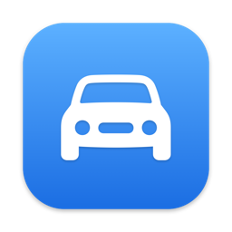
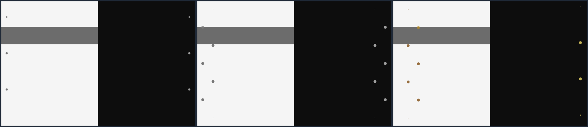
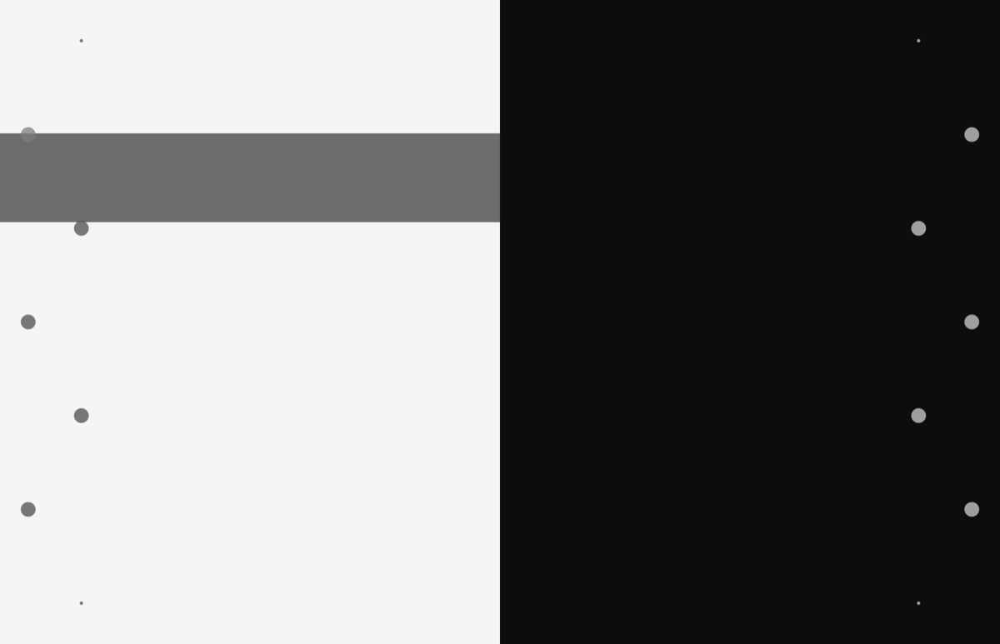
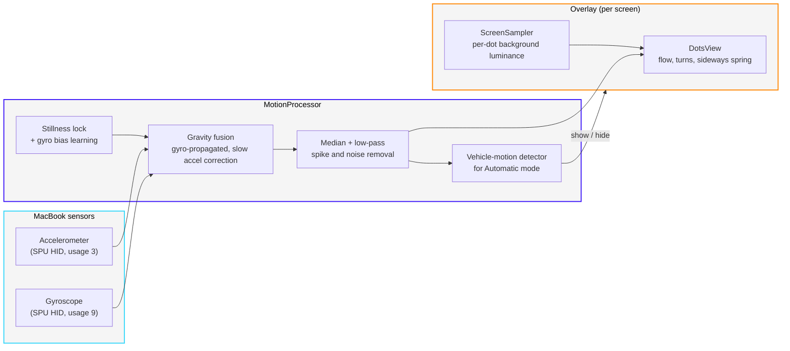

<div align="center">



# Motion Cues for Mac

**Vehicle motion cues for your MacBook: read comfortably on the train, bus or car without motion sickness.**

[](https://github.com/Spandan2022/MacOS_Motion_Cues/actions/workflows/ci.yml)
[](https://github.com/Spandan2022/MacOS_Motion_Cues/releases)
[](#requirements)
[](#requirements)
[](https://swift.org)
[](LICENSE)

[**Quick start**](#-quick-start) · [**Download**](https://github.com/Spandan2022/MacOS_Motion_Cues/releases/latest) · [**Features**](#-features) · [**FAQ**](#-faq) · [**Report a bug**](https://github.com/Spandan2022/MacOS_Motion_Cues/issues/new/choose)

<br>


<sub>Speeding up, braking and turning in a simulated drive. The dots are dark over the document and light over the photo.</sub>

</div>

<br>

Motion sickness happens when your eyes and your inner ear disagree. Your body feels the car speed up, brake and
turn, but the screen in front of you stays perfectly still. **Motion Cues** brings the idea behind the iPhone's
*Vehicle Motion Cues* to the Mac. Dots along the edges of your screen move with the vehicle, so what you see
matches what you feel.

It uses the **accelerometer and gyroscope already built into Apple Silicon MacBooks**. It needs no phone, extra
hardware or account, and everything runs locally.

> [!NOTE]
> Motion Cues is an independent open-source project. It is not affiliated with or endorsed by Apple.

## 🚀 Quick start

On an Apple Silicon MacBook running macOS 14 or later, paste this into **Terminal**:

```bash
curl -fsSL https://raw.githubusercontent.com/Spandan2022/MacOS_Motion_Cues/main/install.sh | bash
```

That downloads the latest release, installs **Motion Cues** into Applications and launches it. Then click the
**car icon** in the menu bar:

| | Step | Why |
|:-:|---|---|
| **1** | **Advanced ▸ Direction ▸ Calibrate…** | A one-time, 10-second setup so the dots move the right way on your Mac |
| **2** | **Launch at Login** | Keeps it ready for every ride |
| **3** | Leave **Show Motion Cues** on **Automatic** | The dots appear on their own once you're moving |

<sub>Prefer not to use Terminal? See [other ways to install](#-installation).</sub>

## ✨ Features

<table>
<tr>
<td width="33%" valign="top">

### 🧭 Built-in sensing
Reads the MacBook's own accelerometer and gyroscope at 100 Hz. Sensor fusion keeps gentle, sustained acceleration
visible, like a train slowly pulling out.

</td>
<td width="33%" valign="top">

### 🌊 Endless flowing dots
Speeding up and braking make the dot columns flow. Dots stream off one edge and grow back in at the other, so the
columns feel endless.

</td>
<td width="33%" valign="top">

### ↪️ Turns you can see
In a turn, the two sides flow in opposite directions while the columns lean sideways. Strong motion brings in a
second column.

</td>
</tr>
<tr>
<td valign="top">

### 🎨 Per-dot adaptive color
Each dot samples the pixels directly behind it, turning dark over a white page and light over a dark photo.
Colored dots keep their hue.

</td>
<td valign="top">

### 🤖 Smart Automatic mode
Turns on after a few seconds of steady vehicle motion. Walking around with your laptop, typing or sitting still
won't set it off.

</td>
<td valign="top">

### 🫥 Out of your way
Lives in the menu bar and is click-through. Works on every display and Space, including full-screen apps, and
stays out of screenshots. About 2% CPU, with no network access.

</td>
</tr>
</table>

### How the dots move

<p align="center">
  
  <br>
  <sub>At rest · braking hard (a second column appears) · turning left with yellow dots</sub>
</p>

| When the vehicle… | the dots… |
|---|---|
| 🚗 **speeds up** | flow **down**, like being pressed back into your seat |
| 🛑 **brakes** | flow **up** |
| ↩️ **turns left** | flow up on the left and down on the right as the scenery rotates, and shift right |
| ↪️ **turns right** | do the reverse |
| 💨 **moves hard** | grow slightly, and a **second inner column** fades in |
| 🅿️ **stops** | stop where they are (the columns are endless) |
| 🤲 *(you pick up the laptop)* | ignore it: the gyro detects handling |

## 📦 Installation

### Requirements

| | |
|---|---|
| **Mac** | An Apple Silicon **MacBook** (Air or Pro). Desktop and Intel Macs have no built-in motion sensor. |
| **macOS** | 14 Sonoma or later |
| **To build from source** | Xcode or the Command Line Tools (`xcode-select --install`) |

### Option 1: One-line install (recommended)

```bash
curl -fsSL https://raw.githubusercontent.com/Spandan2022/MacOS_Motion_Cues/main/install.sh | bash
```

This checks that your Mac is supported and installs to `/Applications` (or `~/Applications` if you're not an admin).
Running it again updates you to the latest version. Because the app arrives through `curl` rather than a browser,
there's no "unidentified developer" prompt. [Read the script](install.sh) first if you like.

<details>
<summary><b>Installer options</b></summary>

<br>

| Command | What it does |
|---|---|
| `curl -fsSL …/install.sh \| bash` | Install or update to the latest release |
| `curl -fsSL …/install.sh \| bash -s -- --from-source` | Build and install from source |
| `curl -fsSL …/install.sh \| bash -s -- --uninstall` | Remove the app, its settings and its permissions |

</details>

### Option 2: Download the DMG

1. Download **MotionCues-x.y.z.dmg** from the [latest release](https://github.com/Spandan2022/MacOS_Motion_Cues/releases/latest).
2. Open it and drag **Motion Cues** into **Applications**.
3. Open Motion Cues, and turn on **Launch at Login** in its menu.

> [!IMPORTANT]
> Releases aren't notarized by Apple yet, so macOS blocks a browser-downloaded copy the first time. To allow it
> once: try to open it, then go to **System Settings ▸ Privacy & Security** and click **Open Anyway**.

### Option 3: Build from source

```bash
git clone https://github.com/Spandan2022/MacOS_Motion_Cues.git
cd MacOS_Motion_Cues
./start.sh            # builds, installs to ~/Applications and launches
```

After that it's a normal app, so you can close Terminal. `./start.sh --log` shows live motion data, and
`./start.sh --stop` quits.

> [!TIP]
> With an Apple Development or Developer ID certificate in your keychain, builds are signed automatically and
> macOS remembers your Screen Recording permission across rebuilds. Set `CODESIGN_IDENTITY` to choose one.

## ⚙️ Settings

Everything is in the menu-bar menu. Appearance and tuning live under **Advanced**.

| Setting | Options | Default |
|---|---|---|
| **Show Motion Cues** | Off · On · Automatic | **Automatic** |
| **Dot Size** | Small · Medium · Large | Medium |
| **Dot Density** | Low · Medium · High | Medium |
| **Dot Color** | Greyscale (adaptive) · Blue · Yellow · Green · Red · Purple · White · Black | **Greyscale** |
| **Dot Opacity** | 35% · 50% · 75% · 100% | 75% |
| **Sensitivity** | Low · Medium · High · Max | Medium |
| **Direction** | Calibrate… · Invert front/back · Invert left/right · Invert turns | Calibrate once |
| **Test Motion** | Speed Up · Brake · Turn Left · Turn Right · Stop-and-Go Drive | — |

### 🎨 Adaptive color



Each dot independently checks the roughly 48×48 px patch behind it, 15 times per second. Dots over a dark photo and
dots over a white text box therefore adapt differently.

- **Greyscale**: dark grey on bright backgrounds, off-white on dark ones.
- **Colors**: keep their hue. They get deeper and more saturated on bright backgrounds (yellow turns amber), and brighter on dark ones.
- **White / Black**: fixed colors that need no screen access.

<br clear="right">

## 🔒 Privacy

- **No network.** Motion Cues never connects to the internet.
- **Motion sensor:** read locally through IOKit, with no permission or root needed.
- **Screen Recording** *(adaptive colors only)*: the app reads a tiny 1/16-resolution, 8 fps image of the screen, with
  the dots excluded, to pick each dot's tone. It isn't saved, and no audio is captured. While it's active, macOS shows
  its recording indicator in the menu bar. Choose **White** or **Black** dots to avoid it entirely.

## ❓ FAQ

<details>
<summary><b>Does it work on my Mac?</b></summary>

<br>

It needs an Apple Silicon **MacBook** (Air or Pro) on macOS 14+. It was developed on an M2 Pro MacBook Pro, and other
Apple Silicon MacBooks should work. Please [send a ride report](https://github.com/Spandan2022/MacOS_Motion_Cues/issues/new/choose)
either way. iMac, Mac mini, Mac Studio, Mac Pro and Intel Macs have no built-in motion sensor.
</details>

<details>
<summary><b>The dots move the wrong way</b></summary>

<br>

Run **Advanced ▸ Direction ▸ Calibrate…** with the laptop on a table, or flip the Invert options by hand. The dots
assume you face the same way as the keyboard.
</details>

<details>
<summary><b>The dots are always the same grey</b></summary>

<br>

Adaptive color needs **Screen Recording** permission. Use **Advanced ▸ Allow Screen Recording…**, turn on Motion
Cues, then **Relaunch Motion Cues** from the same menu.
</details>

<details>
<summary><b>macOS keeps asking for Screen Recording</b></summary>

<br>

Current releases are ad-hoc signed, so each new version looks like a new app to macOS and it asks once after every
update. Builds from source signed with your own development certificate keep the permission.
</details>

<details>
<summary><b>Automatic mode doesn't turn on (or turns on when it shouldn't)</b></summary>

<br>

Automatic waits for about 2.5 s of steady acceleration, braking or turning. Very smooth rides can stay below that, so
use **On** or raise **Sensitivity**. If it triggers while you're not moving, please
[open a ride report](https://github.com/Spandan2022/MacOS_Motion_Cues/issues/new/choose) with a `./start.sh --log` capture.
</details>

<details>
<summary><b>"Motion Cues can't be opened"</b></summary>

<br>

That's Gatekeeper blocking an unnotarized download. Allow it once in **System Settings ▸ Privacy & Security ▸ Open
Anyway**, or install with the [one-line installer](#option-1-one-line-install-recommended).
</details>

<details>
<summary><b>How do I uninstall it?</b></summary>

<br>

```bash
curl -fsSL https://raw.githubusercontent.com/Spandan2022/MacOS_Motion_Cues/main/install.sh | bash -s -- --uninstall
```

If you turned on Launch at Login, also remove it in **System Settings ▸ General ▸ Login Items**.
</details>

## ⚠️ Known limitations

- **Undocumented sensor interface:** macOS has no public API for the MacBook motion sensor, so a future macOS update could change or block it.
- **Early tuning:** sensitivity, flow speed and the Automatic thresholds come from desk measurements and simulated drives. Real rides will refine them.
- **Unnotarized releases:** a browser-downloaded copy needs a one-time **Open Anyway** (the one-line installer avoids this).

## 🛠️ For developers

<details>
<summary><b>How it works</b></summary>

<br>



- **Sensor access:** the accelerometer and gyroscope appear as `AppleSPUHIDDevice` services (vendor usage page
  `0xFF00`, usages 3 and 9). They stay silent until the driver's `SensorPropertyReportingState`,
  `SensorPropertyPowerState` and `ReportInterval` properties are set. Each report is then 22 bytes with three
  little-endian `Int32` values at offset 6, in 16.16 fixed point (g or °/s).
- **Gravity tracking:** propagated with the gyro and corrected toward the accelerometer over about 12 s. The gyro's
  sign is learned from the first few tilts. When the laptop is perfectly still, gravity is re-locked and the gyro bias
  re-learned to prevent drift.
- **Vehicle frame:** the leftover acceleration is projected onto the horizontal plane. The sensor's x axis is
  left/right, and the axis perpendicular to it and to gravity is front/back.
- **Automatic mode:** about 2.5 s of steady acceleration (≥ 0.035 g) or a steady turn, with no tilting or footstep
  jolts.

</details>

<details>
<summary><b>Project layout</b></summary>

<br>

A single Swift package with no dependencies.

```
Sources/MotionCues/
├── App.swift                   # Menu bar, Automatic mode, test motions, calibration
├── Settings.swift              # Preferences and adaptive color math
├── Sensor/SPUSensor.swift      # Enables and reads the SPU accelerometer/gyro via IOKit HID
├── Sensor/MotionSource.swift   # Vec3 and reading types
├── Motion/MotionProcessor.swift# Fusion, filtering, stillness, vehicle-motion detection
├── Overlay/OverlayController.swift # Click-through window per screen
├── Overlay/DotsView.swift      # Dot layout and animation (Core Animation)
├── Overlay/ScreenSampler.swift # ScreenCaptureKit background sampling
├── RenderTest.swift            # Offscreen renders and demo frames
└── AutoTest.swift              # Synthetic Automatic-mode scenarios (run in CI)
scripts/bundle.sh               # Build, bundle, sign (and install unless --no-install)
scripts/package.sh              # Release DMG + zip (notarizes when configured)
scripts/make_icon.swift         # Renders the app icon
install.sh                      # One-line installer
start.sh                        # Build-if-needed and launch (development)
.github/workflows/              # CI and tag-triggered releases
```

</details>

<details>
<summary><b>Debug commands</b></summary>

<br>

```bash
swift build                                       # debug build
.build/debug/MotionCues --log                     # live sensor/processing readout
.build/debug/MotionCues --simulate drive          # drive | speedup | brake | left | right
.build/debug/MotionCues --auto-test               # Automatic-mode scenarios (exit 1 on failure)
.build/debug/MotionCues --render-test <dir>       # render dot states to PNGs offscreen
.build/debug/MotionCues --render-demo <dir>       # frames for the demo GIF
scripts/package.sh                                # dist/MotionCues-<version>.dmg and .zip
MOTIONCUES_CAPTURABLE=1 .build/debug/MotionCues   # let screenshots include the dots
```

</details>

## 🤝 Contributing

Contributions are welcome, and the most valuable kind right now is a
[**ride report**](https://github.com/Spandan2022/MacOS_Motion_Cues/issues/new/choose): how the dots felt in a real car,
bus or train on your Mac. See [CONTRIBUTING.md](CONTRIBUTING.md) for setup, tests and releases, and
[CHANGELOG.md](CHANGELOG.md) for what's new. Please follow the [Code of Conduct](CODE_OF_CONDUCT.md).

## 📄 License

Copyright © 2026 Spandan2022 and contributors. Motion Cues is free software under the
[GNU General Public License v3.0 or later](LICENSE). It is distributed in the hope that it will be useful, but
**without any warranty**.

<div align="center">
<br>
<sub>Inspired by the iOS <b>Vehicle Motion Cues</b> accessibility feature · Built with AppKit, Core Animation, IOKit and ScreenCaptureKit</sub>
</div>
