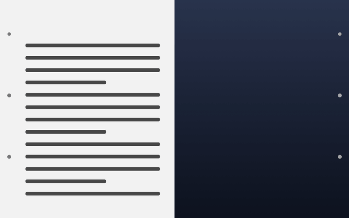

# Motion Cues for Mac

**Vehicle motion cues for your MacBook: read comfortably on the train, bus or car without motion sickness.**

<p>
  <a href="https://github.com/Spandan2022/MacOS_Motion_Cues/releases/latest"></a>
  <a href="LICENSE"></a>
  <a href="#requirements"></a>
  <a href="#requirements"></a>
  <a href="https://swift.org"></a>
</p>

[Install](#install) · [Download](https://github.com/Spandan2022/MacOS_Motion_Cues/releases/latest) · [Features](#features) · [Settings](#settings) · [FAQ](#faq) · [Report a bug](https://github.com/Spandan2022/MacOS_Motion_Cues/issues/new/choose)



<sub>Motion Cues running on a MacBook Pro: switched on from the menu bar, with the dots moving along both screen edges.</sub>

---

Motion sickness happens when your eyes and your inner ear disagree. You feel the car speed up, brake and turn,
but the screen in front of you stays perfectly still. Motion Cues brings the idea behind the iPhone's *Vehicle
Motion Cues* to the Mac. Dots along the edges of your screen move with the vehicle, so what you see matches what
you feel.

It runs on the **accelerometer and gyroscope already inside Apple Silicon MacBooks**. You don't need a phone, extra
hardware or an account, and nothing leaves your Mac.

> [!NOTE]
> Motion Cues is an independent open-source project and is not affiliated with Apple.

## Install

Paste this into **Terminal**:

```bash
curl -fsSL https://raw.githubusercontent.com/Spandan2022/MacOS_Motion_Cues/main/install.sh | bash
```

It checks that your Mac is supported, installs the latest release into Applications and opens it. Then, from the
**car icon** in the menu bar:

1. Choose **Advanced ▸ Direction ▸ Calibrate…**. This is a one-time, 10-second setup so the dots move the right way.
2. Turn on **Launch at Login**.
3. Leave **Show Motion Cues** on **Automatic**. The dots appear by themselves once you're moving.

Running the same command again updates to the newest version. To remove the app, run it with `bash -s -- --uninstall`.

### Requirements

- An **Apple Silicon MacBook** (Air or Pro). Desktop and Intel Macs have no built-in motion sensor.
- **macOS 14** Sonoma or later.

### Other ways to install

**Download the DMG.** Get **MotionCues-x.y.z.dmg** from the
[latest release](https://github.com/Spandan2022/MacOS_Motion_Cues/releases/latest) and drag Motion Cues into
Applications. Releases aren't notarized by Apple yet, so the first time you open it, go to **System Settings ▸
Privacy & Security** and click **Open Anyway**. The Terminal install above skips this step.

**Build from source.** This needs Xcode or the Command Line Tools (`xcode-select --install`).

```bash
git clone https://github.com/Spandan2022/MacOS_Motion_Cues.git
cd MacOS_Motion_Cues
./start.sh
```

`start.sh` builds the app, installs it to `~/Applications` and opens it. After that you can close Terminal.

## Features

- **Uses the sensors you already have.** It reads the MacBook's built-in accelerometer and gyroscope 100 times a
  second. Sensor fusion keeps gentle, sustained motion visible, like a train slowly pulling out of a station.
- **Endless, flowing dots.** Speeding up and braking make the dot columns flow down and up. Dots slide off one edge
  of the screen and grow back in at the other.
- **Turns you can see.** In a turn, the two sides flow in opposite directions, like the scenery rotating around you,
  and the columns lean sideways. Strong motion brings in a second column.
- **Colors that adapt dot by dot.** Each dot checks the pixels directly behind it, so it's dark over a white page
  and light over a dark photo.
- **Automatic mode that knows the difference.** It turns on after a few seconds of steady vehicle motion. Walking
  around with your laptop, typing or sitting still won't set it off.
- **Stays out of the way.** It lives in the menu bar, lets every click through, and works on all displays and
  Spaces, including full-screen apps. It stays out of screenshots and uses about 2% CPU.

### How the dots respond

| When the vehicle… | the dots… |
|---|---|
| speeds up | flow **down**, like being pressed back into your seat |
| brakes | flow **up** |
| turns left | flow up on the left and down on the right, and shift right |
| turns right | do the opposite |
| moves hard | grow slightly, and a second inner column fades in |
| stops | stop where they are |

Picking up or tilting the laptop is detected with the gyroscope and ignored.

## Settings

Everything is in the menu-bar menu. Appearance and tuning are under **Advanced**.

| Setting | Options | Default |
|---|---|---|
| Show Motion Cues | Off, On, Automatic | Automatic |
| Dot Size | Small, Medium, Large | Medium |
| Dot Density | Low, Medium, High | Medium |
| Dot Color | Greyscale, Blue, Yellow, Green, Red, Purple, White, Black | Greyscale |
| Dot Opacity | 35%, 50%, 75%, 100% | 75% |
| Sensitivity | Low, Medium, High, Max | Medium |
| Direction | Calibrate, or invert front/back, left/right and turns | — |
| Test Motion | Speed up, brake, turn left/right, stop-and-go drive | — |

### Adaptive color


Each dot looks at the small patch of screen behind it 15 times a second and picks a tone that stands out:

- **Greyscale** turns dark grey on bright backgrounds and off-white on dark ones.
- **Colors** keep their hue. They get deeper on bright backgrounds (yellow turns amber) and brighter on dark ones.
- **White** and **Black** stay fixed and don't need to look at the screen at all.

## Privacy

- Motion Cues **never connects to the internet**.
- The motion sensor is read locally and needs no permission.
- Adaptive colors need **Screen Recording** permission. The app reads a tiny, low-resolution image of the screen
  (with the dots left out) only to pick each dot's tone. Nothing is saved, and no audio is captured. While this is
  on, macOS shows its recording indicator in the menu bar. Pick **White** or **Black** dots to turn it off
  completely.

## FAQ

<details>
<summary><b>Will it work on my Mac?</b></summary>

<br>

It needs an Apple Silicon MacBook (Air or Pro) on macOS 14 or later. It was developed on an M2 Pro MacBook Pro, and
other Apple Silicon MacBooks should work too. If you try it, please
[send a ride report](https://github.com/Spandan2022/MacOS_Motion_Cues/issues/new/choose). iMac, Mac mini, Mac Studio,
Mac Pro and Intel Macs don't have the motion sensor.
</details>

<details>
<summary><b>The dots move the wrong way</b></summary>

<br>

Run **Advanced ▸ Direction ▸ Calibrate…** with the laptop on a table, or flip the invert options by hand. The dots
assume you're facing the same way as the keyboard.
</details>

<details>
<summary><b>The dots are always the same grey</b></summary>

<br>

Adaptive color needs Screen Recording permission. Choose **Advanced ▸ Allow Screen Recording…**, turn on Motion
Cues, then choose **Relaunch Motion Cues** from the same menu.
</details>

<details>
<summary><b>macOS keeps asking for Screen Recording</b></summary>

<br>

Current releases aren't signed with a developer certificate, so macOS treats each new version as a new app and asks
once after every update.
</details>

<details>
<summary><b>Automatic mode doesn't turn on</b></summary>

<br>

It waits for about 2.5 seconds of steady acceleration, braking or turning, and very smooth rides can stay below that.
Switch to **On**, or raise **Sensitivity**. If it turns on when you're *not* moving, please
[open a ride report](https://github.com/Spandan2022/MacOS_Motion_Cues/issues/new/choose).
</details>

<details>
<summary><b>"Motion Cues can't be opened"</b></summary>

<br>

That's macOS blocking a download from an unverified developer. Allow it once in **System Settings ▸ Privacy &
Security ▸ Open Anyway**, or use the [Terminal install](#install), which avoids it.
</details>

## Known limitations

- macOS has no public API for the MacBook motion sensor, so a future macOS update could break access to it.
- The sensitivity and Automatic thresholds are tuned from desk tests and simulated drives. Real rides will refine them.
- Releases aren't notarized yet, so a browser-downloaded copy needs a one-time **Open Anyway**.

## Development

Motion Cues is a single Swift package with no dependencies.

```bash
swift build                                  # debug build
.build/debug/MotionCues --log                # live motion readout
.build/debug/MotionCues --auto-test          # Automatic-mode scenarios (also run in CI)
.build/debug/MotionCues --simulate drive     # drive, speedup, brake, left, right
.build/debug/MotionCues --render-demo <dir>  # frames for the demo GIF
scripts/package.sh                           # release DMG and zip in dist/
```

<details>
<summary><b>How it works</b></summary>

<br>

- **Sensor access.** The accelerometer and gyroscope appear as `AppleSPUHIDDevice` services (vendor usage page
  `0xFF00`, usages 3 and 9). They stay silent until the driver's `SensorPropertyReportingState`,
  `SensorPropertyPowerState` and `ReportInterval` properties are set. After that, each 22-byte report holds three
  little-endian `Int32` values at offset 6, in 16.16 fixed point (g, or degrees per second).
- **Gravity tracking.** Gravity is rotated with the gyro and corrected toward the accelerometer over about 12
  seconds. The gyro's sign is learned from the first few tilts. When the laptop is perfectly still, gravity is
  re-locked and the gyro bias re-learned, which prevents drift.
- **Vehicle frame.** The acceleration left over is projected onto the horizontal plane. The sensor's x axis is
  left/right, and the axis perpendicular to it and to gravity is front/back.
- **Automatic mode.** It needs about 2.5 seconds of steady acceleration (0.035 g or more) or a steady turn, with no
  tilting or footstep jolts.

</details>

<details>
<summary><b>Project layout</b></summary>

<br>

```
Sources/MotionCues/
├── App.swift                       Menu bar, Automatic mode, test motions, calibration
├── Settings.swift                  Preferences and adaptive color
├── Sensor/SPUSensor.swift          Reads the accelerometer and gyro through IOKit HID
├── Motion/MotionProcessor.swift    Fusion, filtering, stillness, vehicle-motion detection
├── Overlay/DotsView.swift          Dot layout and animation
├── Overlay/ScreenSampler.swift     Background sampling for adaptive color
├── Overlay/OverlayController.swift Click-through window on each screen
├── AutoTest.swift                  Synthetic Automatic-mode scenarios
└── RenderTest.swift                Offscreen renders and demo frames
scripts/                            Build, package and icon scripts
install.sh                          One-line installer
start.sh                            Build and launch for development
```

</details>

## Contributing

Contributions are welcome. The most useful one right now is a
[ride report](https://github.com/Spandan2022/MacOS_Motion_Cues/issues/new/choose): how the dots felt in a real car,
bus or train, on your Mac. See [CONTRIBUTING.md](CONTRIBUTING.md) to get set up, and [CHANGELOG.md](CHANGELOG.md)
for what's changed.

## License

Copyright © 2026 Spandan2022 and contributors. Released under the
[GNU General Public License v3.0 or later](LICENSE).
